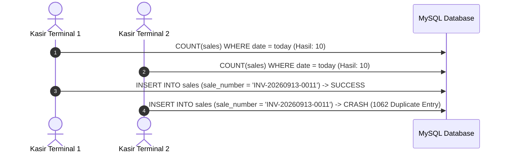
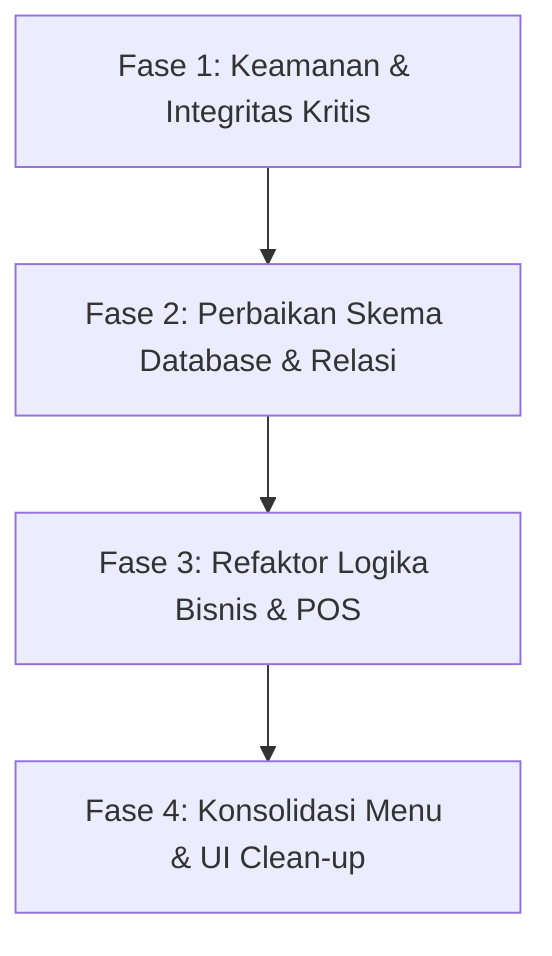

# SYSTEM AUDIT REPORT: APOTEK KINANTHI
**Tanggal Audit:** 13 September 2026  
**Auditor:** Principal Software Architect, Cybersecurity Auditor, & Healthcare System Business Analyst  
**Target Codebase:** Laravel 11, Inertia.js, Vue 3, TanStack Vue Query, MySQL  
**Status Mode:** STRICT READ-ONLY AUDIT (Ponytail Analysis Mode)

---

## 1. Executive Summary

| Metrik Penilaian | Skor | Status | Ringkasan Dampak |
|---|---|---|---|
| **Arsitektur & Navigasi (IA)** | 62 / 100 | Marginal | Redundansi antar menu master data & log, duplikasi halaman katalog racikan. |
| **Logika Bisnis & Farmasi (SOP)** | 54 / 100 | Kritis | Kebocoran stok racikan di kasir, kalkulasi HPP tidak akurat, desinkronisasi stok gudang-kasir. |
| **Keamanan & Otorisasi (RBAC)** | 48 / 100 | Bahaya | Client-side price tampering di kasir checkout (harga dapat dimanipulasi ke Rp 0), ketiadaan Laravel Policy. |
| **Integritas Data & Database** | 45 / 100 | Kritis | Race condition pembuatan nomor faktur/resep (`count()+1`), kolom migrasi hilang di tabel produksi (`prescription_items`, `patients`), double-counting stok. |
| **Frontend Cache & Reaktivitas** | 58 / 100 | Butuh Perhatian | Zero cache invalidation pada TanStack Vue Query (`staleTime: 60s`), potensi data usang (stale data). |
| **OVERALL SYSTEM HEALTH SCORE** | **53 / 100** | **AT RISK (Perlu Remediasi Prioritas)** | Sistem rentan terhadap manipulasi finansial, crash saat beban tinggi, dan selisih stok fisik vs sistem. |

### Ringkasan Kondisi Sistem
Apotek Kinanthi memiliki fondasi stack modern (Laravel 11 + Inertia.js + Vue 3) dengan antarmuka yang bersih. Namun, terdapat celah struktural antara ekspektasi logika bisnis farmasi dengan implementasi database:
1. **Financial Exploit Risk:** Kasir dapat mengirimkan nilai `unit_price` sewenang-wenang via payload HTTP pada transaksi resep maupun OTC, dan backend menyimpannya tanpa validasi silang terhadap master harga jual.
2. **Missing Schema Attributes:** Model Eloquent mengacu pada kolom yang tidak ada pada tabel fisik MySQL (`prescription_items.compounded_product_id`, `prescription_items.status`, `patients.notes`), berisiko memicu crash `QueryException 1054 Unknown Column` sewaktu fitur resep digunakan.
3. **Ghost Stock on Compounding:** Penjualan obat racikan di modul kasir tidak pernah memotong `CompoundedProduct::qty_hasil`. Stok racikan menjadi tidak terbatas dan tidak terlacak.
4. **Data Corruption Under Concurrency:** Penomoran transaksi (`sale_number`) dan resep (`prescription_number`) menggunakan `count() + 1` tanpa database locking, berisiko memicu `1062 Duplicate entry` saat transaksi kasir dilakukan bersamaan.

---

## 2. Menu Restructuring Matrix (Information Architecture & Redundansi)

Berdasarkan inspeksi terhadap [ControlLayout.vue](file:///d:/Projek/KP_Apotek_Kinanthi/resources/js/Layouts/ControlLayout.vue) dan [routes/web.php](file:///d:/Projek/KP_Apotek_Kinanthi/routes/web.php), berikut matriks perampingan navigasi:

### A. Role Admin

| Menu Saat Ini | Rute & Komponen Terkait | Status Rekomendasi | Usulan Aksi & Justifikasi Operasional |
|---|---|---|---|
| **Dashboard** | `control.admin.dashboard` (`Dashboard.vue`) | **Pertahankan** | Pusat ringkasan metrik eksekutif harian, ringkasan omzet, dan peringatan kedaluwarsa. |
| **Katalog Obat -> Katalog Faktur** | `control.admin.medicines.faktur` (`Medicines.vue`) | **Gabung (Merge)** | **Redundan dengan Faktur Masuk.** Katalog Faktur hanya menampilkan tabel read-only dari tabel `incoming_stocks`. Sebaiknya digabung ke dalam menu tunggal **"Katalog & Stok Obat"** yang menyajikan master obat jadi beserta rincian batch-nya. |
| **Katalog Obat -> Katalog Racikan** | `control.admin.medicines.racikan` (`Medicines.vue`) | **Hapus (Dead Code)** | **100% duplikasi.** Menu ini merender `CompoundedProduct`, yang persis sama dengan menu mandiri `Produk Racikan` (`CompoundedProducts.vue`). |
| **Supplier / PBF** | `control.admin.suppliers` (`Suppliers.vue`) | **Pertahankan** | Master data esensial untuk traceability distributor obat dan PBF resmi. |
| **Bahan Baku** | `control.admin.raw-materials` (`RawMaterials.vue`) | **Pertahankan** | Master data bahan baku racikan, pengadaan sediaan murni, dan penetapan threshold minimum. |
| **Produk Racikan** | `control.admin.compounded-products` (`CompoundedProducts.vue`) | **Gabung (Merge)** | Satukan dengan tab katalog sediaan obat. Pisahkan antara obat pabrikan (ethical/OTC) dan produk racikan standar apotek dalam satu interface terpadu. |
| **Penetapan Harga** | `control.admin.pricing.index` (`Pricing.vue`) | **Pertahankan** | **Fungsi vital.** Wewenang eksklusif Admin untuk menetapkan tuslah/jasa racik, margin keuntungan, dan harga jual berjenjang (besar, menengah, kecil). |
| **Faktur Masuk** | `control.admin.incoming-stocks` (`IncomingStocks.vue`) | **Pertahankan (Pusat Logistik)** | Gerbang utama penerimaan barang dari PBF, pencatatan nomor batch, faktur fisik, dan tanggal kedaluwarsa. |
| **Distribusi Stok** | `control.admin.inventory.distribution` (`Distribution.vue`) | **Pertahankan** | Kontrol transfer stok internal dari Gudang Utama ke Sub-Gudang / Kasir POS. |
| **Stock Opname** | `control.admin.stock-opname.index` (`StockOpname.vue`) | **Pertahankan (Perbaiki Logika)** | Audit fisik stok berkala. Perlu perbaikan logika alokasi selisih agar per-batch, bukan global. |
| **Retur Obat** | `control.admin.returns.index` (`Returns.vue`) | **Pertahankan** | Pengembalian obat rusak/mendekati ED ke PBF rekanan. |
| **Laporan Penjualan** | `control.admin.reports.sales` (`SalesReport.vue`) | **Pertahankan** | Laporan omzet & laba rugi. Wajib ditambahkan kalkulasi produk racikan. |
| **Monitoring Transaksi** | `control.admin.reports.cashier-monitoring` (`CashierMonitoring.vue`) | **Pertahankan** | Pengawasan pergerakan kas kasir per shift. |
| **Log Stok** | `control.admin.stock-logs` (`StockLogs.vue`) | **Gabung (Merge)** | **Redundan dengan Audit Trail.** Mengambil data dari `stock_mutations`. Gabungkan menu `Log Stok` dan `Audit Trail` ke dalam satu submenu komprehensif: **"Jejak Audit & Mutasi"** dengan tab filter tipe (Aktivitas Pengguna vs Mutasi Stok Fisik). |
| **Audit Trail** | `control.admin.audit-trails` (`AuditTrail.vue`) | **Gabung (Merge)** | Gabungkan ke dalam entitas pelaporan terpadu bersama Log Stok. |
| **Pengguna & Pengaturan** | `control.admin.users` & `settings` | **Pertahankan** | Manajemen akun staf (Admin, Apoteker, Kasir) dan parameter sistem. |

---

### B. Role Apoteker

| Menu Saat Ini | Rute & Komponen Terkait | Status Rekomendasi | Usulan Aksi & Justifikasi Operasional |
|---|---|---|---|
| **Dashboard** | `control.apoteker.dashboard` | **Pertahankan** | Monitoring klinis antrean resep masuk, racikan aktif, dan obat menipis. |
| **Resep Pasien** | `control.apoteker.prescriptions.index` | **Pusat Alur (Pertahankan)** | Modul inti penerimaan resep dokter, skrining klinis, dan validasi dosis. |
| **Racikan Aktif** | `control.apoteker.submissions` | **Gabung (Workflow Terpadu)** | Saat ini terpisah dari Resep. Apoteker harus berpindah menu dari Resep -> Mulai Racik -> Submissions. Sebaiknya peracikan menjadi sub-proses langsung di dalam antarmuka tiket resep (Single Pane of Glass). |
| **Formula Obat** | `control.apoteker.formulas` | **Pertahankan** | Master resep standar (standar formularium apotek / resep dokter langganan). Tambahkan aksi Update dan Delete. |
| **Stok Bahan Baku** | `control.apoteker.raw-materials` | **Gabung (Merge)** | Duplikasi dengan `Cek Stok Obat`. Satukan ke dalam satu inventaris lab racikan. |
| **Cek Stok Obat** | `control.apoteker.stock-check` | **Pertahankan** | Pencarian cepat ketersediaan obat jadi dan sisa bahan baku saat verifikasi resep. |
| **BUD Tracker** | `control.apoteker.bud-tracker` | **Pertahankan** | Fitur kepatuhan mutu farmasi (Beyond Use Date) untuk memantau stabilitas obat racikan. |
| **Audit & Mutasi** | `control.apoteker.stock-audit` | **Perbaiki Data Source** | Saat ini hanya membaca tabel `stock_logs` yang parsial. Alihkan query ke `stock_mutations` agar apoteker melihat riwayat mutasi bahan racikan secara riil. |

---

### C. Role Kasir

| Menu Saat Ini | Rute & Komponen Terkait | Status Rekomendasi | Usulan Aksi & Justifikasi Operasional |
|---|---|---|---|
| **Antrian / Dashboard** | `control.kasir.queue` | **Pertahankan** | Antrean resep siap serah dan pembayaran obat racikan/resep. |
| **Penjualan OTC** | `control.kasir.otc.index` | **Pertahankan** | Kasir penjualan langsung non-resep (Over-The-Counter). |
| *(Baru Diajukan)* **Tutup Shift Kasir** | Belum ada | **Tambah Baru** | Rekonsiliasi fisik uang tunai di laci kasir vs total transaksi sistem sebelum handover shift. |

---

## 3. Business Workflow Flaws (Celah Operasional Apotek)

### Temuan 1: Bypass Pembayaran Racikan & Penjualan Harga Rp 0
- **Lokasi Kode:** [ApotekerPrescriptionController.php:122-149](file:///d:/Projek/KP_Apotek_Kinanthi/app/Http/Controllers/Control/Apoteker/ApotekerPrescriptionController.php#L122-L149), [KasirSaleController.php:70-116](file:///d:/Projek/KP_Apotek_Kinanthi/app/Http/Controllers/Control/Kasir/KasirSaleController.php#L70-L116), [Checkout.vue:25-28](file:///d:/Projek/KP_Apotek_Kinanthi/resources/js/Pages/Control/Kasir/Checkout.vue#L25-L28)
- **Mekanisme Celah:**
  1. Apoteker menyelesaikan peracikan resep. Sesuai aturan wewenang, Apoteker tidak boleh menetapkan harga jual, sehingga produk racikan dibuat dengan status `pricing_status = 'pending_price'` dan `harga_jual = 0`.
  2. Apoteker langsung mengubah status resep menjadi `siap_ambil`.
  3. Resep langsung muncul di antrean Kasir (`Queue.vue`).
  4. Pada [Checkout.vue baris 26](file:///d:/Projek/KP_Apotek_Kinanthi/resources/js/Pages/Control/Kasir/Checkout.vue#L26):
     ```javascript
     unit_price: item.item_type === 'racikan' 
         ? Number(item.compounded_product?.harga_jual || 0) 
         : ...
     ```
     Jika Admin belum sempat membuka menu `Penetapan Harga`, nilai `item.compounded_product.harga_jual` masih bernilai `0`.
  5. Kasir dapat langsung menekan tombol Checkout dan menyimpan transaksi. Pasien mendapatkan obat racikan secara gratis (Rp 0), tanpa ada peringatan atau validasi di backend bahwa status harga racikan masih `pending_price`.
- **Dampak Operasional:** Kerugian finansial langsung pada apotek akibat penyerahan obat racikan tanpa pelunasan biaya obat dan jasa peracikan.

---

### Temuan 2: Kebocoran Stok Produk Racikan (Ghost Inventory Leak)
- **Lokasi Kode:** [KasirSaleController.php:270-274](file:///d:/Projek/KP_Apotek_Kinanthi/app/Http/Controllers/Control/Kasir/KasirSaleController.php#L270-L274)
- **Mekanisme Celah:**
  Di dalam method `otcStore` pada `KasirSaleController`:
  ```php
  if ($itemData['item_type'] === 'obat_jadi' && $medicineId) {
      $this->deductKasirStock((int) $medicineId, (float) $itemData['quantity'], $sale, (int) auth()->id(), 'otc');
  }
  ```
  Jika pembeli membeli produk racikan di loket OTC (`item_type === 'racikan'`), **tidak ada pemotongan stok pada tabel `compounded_products` kolom `qty_hasil`**.
- **Dampak Operasional:** Stok produk racikan di sistem tetap utuh selamanya, meskipun produk fisiknya telah habis terjual ke konsumen.

---

### Temuan 3: Double-Counting Stok Akibat Timpaan Pointer `incoming_stock_id`
- **Lokasi Kode:** [IncomingStockService.php:104-120](file:///d:/Projek/KP_Apotek_Kinanthi/app/Services/IncomingStockService.php#L104-L120) & [Medicine.php:107-123](file:///d:/Projek/KP_Apotek_Kinanthi/app/Models/Control/Medicine.php#L107-L123)
- **Mekanisme Celah:**
  Pada `IncomingStockService`:
  ```php
  $wi = WarehouseInventory::firstOrCreate(
      ['medicine_id' => $stock->medicine_id, 'batch_no' => $stock->batch_no],
      ...
  );
  $wi->update([
      'stock_on_hand' => $wi->stock_on_hand + $qty,
      'incoming_stock_id' => $stock->id,
  ]);
  ```
  Pada `Medicine::recalculateStock()`:
  ```php
  $stokAktifGudang = (float) $this->warehouseInventories()->sum('stock_on_hand');
  $transferredIds = WarehouseInventory::whereNotNull('incoming_stock_id')->pluck('incoming_stock_id')->toArray();
  $stokKarantina = (float) $this->incomingStocks()->whereNotIn('id', $transferredIds)->get()->sum(...);
  $this->update(['stok_total' => $stokKarantina + $stokAktifGudang]);
  ```
  Jika ada 2 faktur masuk berbeda dengan nomor batch yang sama (misal pengiriman bertahap dari supplier), faktur kedua akan menimpa `incoming_stock_id` pada baris `WarehouseInventory`. Akibatnya, faktur pertama tidak lagi tercatat di `$transferredIds` dan dianggap sebagai `$stokKarantina`. Nilai kuantitas faktur pertama dijumlahkan dua kali ke `stok_total`.
- **Dampak Operasional:** Stok total di katalog obat menjadi 1.5x hingga 2x lipat lebih tinggi dari saldo riil di gudang.

---

### Temuan 4: Kegagalan Penanganan Selisih Negatif pada Stock Opname
- **Lokasi Kode:** [AdminStockOpnameController.php:133-159](file:///d:/Projek/KP_Apotek_Kinanthi/app/Http/Controllers/Control/Admin/AdminStockOpnameController.php#L133-L159)
- **Mekanisme Celah:**
  Saat penyesuaian stok opname dijalankan:
  ```php
  $wi = WarehouseInventory::where('medicine_id', $item->medicine_id)->where('status', 'active')->orderBy('expired_date', 'asc')->first();
  if ($wi) {
      $wi->stock_on_hand += $item->difference;
      if ($wi->stock_on_hand < 0) {
          $wi->stock_on_hand = 0;
      }
      $wi->save();
  }
  ```
  Jika obat memiliki selisih fisik minus (-20) dan batch terdekat hanya memiliki sisa 5 unit:
  Nilai batch terdekat dipangkas menjadi 0, tetapi sisa selisih (-15) **hilang begitu saja** tanpa memotong batch-batch berikutnya. Sistem tidak menerapkan pemotongan berantai bertingkat. Selain itu, penyesuaian stok opname dilakukan dengan parameter global `batch_no = 'ALL_BATCHES'` yang melanggar standar CDOB (Cara Distribusi Obat yang Baik) BPOM karena menghilangkan keterlacakan nomor batch fisik.

---

### Temuan 5: Eksklusi Pendapatan Racikan dari Laporan Penjualan
- **Lokasi Kode:** [AdminReportController.php:27-34](file:///d:/Projek/KP_Apotek_Kinanthi/app/Http/Controllers/Control/Admin/AdminReportController.php#L27-L34)
- **Mekanisme Celah:**
  Query laporan penjualan (`getSalesQuery`) hanya mengambil data dari model `Medicine::query()`. Transaksi penjualan obat racikan (`CompoundedProduct`) sama sekali tidak diikutsertakan dalam agregasi laba kotor, omzet, dan ekspor file Excel apotek.
- **Dampak Operasional:** Laporan keuangan apotek tidak mencerminkan pendapatan riil dari laboratorium peracikan.

---

## 4. Security & RBAC Vulnerabilities

| No | File & Baris Kode | Kerentanan | Severity | Dampak Eksploitasi |
|---|---|---|---|---|
| **SEC-01** | [KasirSaleController.php:61-103](file:///d:/Projek/KP_Apotek_Kinanthi/app/Http/Controllers/Control/Kasir/KasirSaleController.php#L61-L103) & [Checkout.vue:100](file:///d:/Projek/KP_Apotek_Kinanthi/resources/js/Pages/Control/Kasir/Checkout.vue#L100) | **Client-Controlled Price Injection (Untrusted Input Trust)** | **HIGH** | Kasir atau aktor dengan akses browser dapat memanipulasi payload `unit_price` menjadi `Rp 0` atau `Rp 1`. Backend langsung menghitung total tagihan dan mencatat struk berdasarkan harga kiriman client tanpa verifikasi ke master database. |
| **SEC-02** | [KasirSaleController.php:222-268](file:///d:/Projek/KP_Apotek_Kinanthi/app/Http/Controllers/Control/Kasir/KasirSaleController.php#L222-L268) | **OTC Price Manipulation** | **HIGH** | Serupa dengan SEC-01, endpoint `otcStore` menerima `unit_price` langsung dari input array request tanpa mengambil nilai `selling_price` obat dari database. |
| **SEC-03** | [ApotekerPrescriptionController.php:77-89](file:///d:/Projek/KP_Apotek_Kinanthi/app/Http/Controllers/Control/Apoteker/ApotekerPrescriptionController.php#L77-L89) & [PrescriptionItem.php:12-23](file:///d:/Projek/KP_Apotek_Kinanthi/app/Models/PrescriptionItem.php#L12-L23) | **Production Database Crash on Prescriptions (Missing Columns)** | **HIGH** | Kode aplikasi mencoba mengisi kolom `compounded_product_id`, `custom_formula_name`, `status`, dan `usage_instructions` pada tabel `prescription_items`. Kolom-kolom ini tidak ada pada skema migrasi database, memicu `SQLSTATE[42S22] Column not found` seketika saat apoteker menginput resep racikan. |
| **SEC-04** | [Prescription.php:30-37](file:///d:/Projek/KP_Apotek_Kinanthi/app/Models/Prescription.php#L30-L37) & [Sale.php:41-45](file:///d:/Projek/KP_Apotek_Kinanthi/app/Models/Sale.php#L41-L45) | **Race Condition on Unique Identifiers** | **HIGH** | Pembuatan `prescription_number` dan `sale_number` menggunakan `count() + 1` tanpa kunci baris pesimistik (`lockForUpdate`). Transaksi bersamaan akan menghasilkan nomor kembar dan memicu `500 Internal Server Error (Integrity constraint violation 1062)` di kasir. |
| **SEC-05** | [RoleControl.php:15-21](file:///d:/Projek/KP_Apotek_Kinanthi/app/Http/Middleware/RoleControl.php#L15-L21) & Codebase Luas | **Absence of Object-Level Authorization (No Policies/Gates)** | **MEDIUM** | Otorisasi hanya berupa filter kasar per-rute `role:admin`, `role:apoteker`, `role:kasir`. Tidak ada Laravel Policy untuk memeriksa kepemilikan resource (IDOR), approval status transition, atau batasan pembatalan transaksi antar kasir. |
| **SEC-06** | [ApotekerCompoundingController.php:269-305](file:///d:/Projek/KP_Apotek_Kinanthi/app/Http/Controllers/Control/Apoteker/ApotekerCompoundingController.php#L269-L305) | **Inconsistent State Reversal on Cancellation** | **MEDIUM** | Saat pengajuan racikan dibatalkan (`cancelSubmission`), stok bahan baku dikembalikan, tetapi entitas `CompoundedProduct` yang terlanjur terbuat tidak dihapus/dibatalkan, dan `PrescriptionItem` tetap berstatus `selesai`. |
| **SEC-07** | [AdminUserController.php:123-143](file:///d:/Projek/KP_Apotek_Kinanthi/app/Http/Controllers/Control/Admin/AdminUserController.php#L123-L143) | **Direct Role Creation via Form Request** | **LOW** | Pembuatan pengguna memvalidasi `role: in:admin,apoteker,kasir`. Karena terlindung middleware `role:admin`, risiko terbatas pada internal admin, namun disarankan menggunakan explicit FormRequest terpisah. |

---

## 5. Data Integrity & Concurrency Risks

### A. Race Condition pada POS Multi-Terminal

- **Analisis:** Menggunakan `count() + 1` pada saat checkout simultan menghasilkan duplikasi nomor invoice. Checkout kasir kedua akan gagal seketika padahal uang fisik telah diterima dari pelanggan.
- **Rekomendasi:** Gunakan generator berbasis UUIDv7, auto-increment table khusus counter sequence, atau sequence per tanggal dengan atomicity.

### B. Konkurensi Mutasi Stok (Pessimistic Locking)
- **Evaluasi Positif:** Pada [KasirSaleController.php baris 322](file:///d:/Projek/KP_Apotek_Kinanthi/app/Http/Controllers/Control/Kasir/KasirSaleController.php#L322) dan [AdminInventoryController.php baris 210](file:///d:/Projek/KP_Apotek_Kinanthi/app/Http/Controllers/Control/Admin/AdminInventoryController.php#L210), kueri inventaris sudah menerapkan `lockForUpdate()`. Hal ini mencegah stok menjadi minus akibat penjualan simultan pada obat jadi.
- **Kelemahan Kritis:** Namun, pada pemotongan bahan baku di [ApotekerCompoundingController.php baris 137](file:///d:/Projek/KP_Apotek_Kinanthi/app/Http/Controllers/Control/Apoteker/ApotekerCompoundingController.php#L137), `RawMaterialStock` **TIDAK MENGGUNAKAN** `lockForUpdate()`. Jika dua apoteker meracik obat menggunakan bahan aktif yang sama pada detik yang sama, saldo stok bahan baku akan mengalami race condition (lost update).

### C. Masalah Desinkronisasi TanStack Vue Query Cache
- **Temuan di Frontend:**
  - File [Medicines.vue:46](file:///d:/Projek/KP_Apotek_Kinanthi/resources/js/Pages/Control/Admin/Medicines.vue#L46) menetapkan `staleTime: 60000` (60 detik).
  - File [StockLogs.vue](file:///d:/Projek/KP_Apotek_Kinanthi/resources/js/Pages/Control/Admin/StockLogs.vue) dan [SalesReport.vue](file:///d:/Projek/KP_Apotek_Kinanthi/resources/js/Pages/Control/Admin/SalesReport.vue) juga menggunakan `useQuery`.
  - **Hasil Grep Audit:** Panggilan `queryClient.invalidateQueries(...)` **sama sekali tidak ditemukan (0 pemanggilan) di seluruh direktori `resources/js`**.
  - **Konsekuensi:** Ketika Admin menambahkan obat baru dari Faktur Masuk, atau Kasir menyelesaikan penjualan, lalu pengguna berpindah halaman menggunakan navigasi Inertia, data yang dirender di layar adalah data usang dari memori cache TanStack selama 60 detik berikutnya, bukan data terbaru dari server.

---

## 6. Actionable Roadmap (Tahapan Remediasi Terarah)

Mengacu pada prinsip arsitektur **Ponytail** (*Lazy Senior Dev Mode*: efisien, minim kode, perbaiki akar masalah sekali di tempat yang tepat, tanpa boilerplate berlebihan):



### Fase 1: Perbaikan Keamanan & Pencegahan Manipulasi Finansial (Prioritas: SEGERA)
1. **Server-Enforced Pricing di Kasir:**
   - Ubah method `store` dan `otcStore` di [KasirSaleController.php](file:///d:/Projek/KP_Apotek_Kinanthi/app/Http/Controllers/Control/Kasir/KasirSaleController.php).
   - Jangan percayai `unit_price` dari request client. Ambil harga resmi langsung dari database:
     * Obat Jadi: `$medicine->selling_price` (atau harga berjenjang sesuai unit).
     * Racikan: `$compoundedProduct->harga_jual`.
   - Tolak transaksi jika harga racikan masih `0` atau `pricing_status !== 'priced'`.
2. **Kunci Atomik Penomoran Struk & Resep:**
   - Ganti generator penomoran di [Sale.php](file:///d:/Projek/KP_Apotek_Kinanthi/app/Models/Sale.php) dan [Prescription.php](file:///d:/Projek/KP_Apotek_Kinanthi/app/Models/Prescription.php) dengan format atomik berbasis ID atau tabel sequence ber-lock untuk mencegah tabrakan duplikat.

---

### Fase 2: Sinkronisasi Skema Database & Migrasi (Prioritas: TINGGI)
1. **Buat File Migrasi Tambahan (Non-Destructive Add Columns):**
   - Tambahkan kolom yang hilang pada tabel `prescription_items`:
     * `foreignId('compounded_product_id')->nullable()->constrained('compounded_products')`
     * `foreignId('compounding_id')->nullable()->constrained('compounding_submissions')`
     * `string('custom_formula_name')->nullable()`
     * `string('usage_instructions')->nullable()`
     * `enum('status', ['pending', 'dikerjakan', 'selesai'])->default('pending')`
   - Tambahkan kolom `notes` pada tabel `patients`.
2. **Koreksi Logika `recalculateStock` pada Model `Medicine`:**
   - Hilangkan ketergantungan rapuh pada `WarehouseInventory::pluck('incoming_stock_id')`.
   - Hitung stok riil murni berdasarkan saldo aktif di tabel `warehouse_inventories` ditambah faktur yang berstatus fisik karantina secara terisolasi.

---

### Fase 3: Penyelarasan Logika Farmasi & Inventaris (Prioritas: MENENGAH)
1. **Pemotongan Stok Produk Racikan di Kasir:**
   - Tambahkan deduksi kuantitas pada `CompoundedProduct::where('id', $id)->decrement('qty_hasil', $qty)` di `KasirSaleController`.
2. **Pessimistic Locking pada Bahan Baku:**
   - Tambahkan `->lockForUpdate()` pada penarikan batch `RawMaterialStock` di `ApotekerCompoundingController` baris 137.
3. **Penyempurnaan Stock Opname:**
   - Lakukan penyesuaian stok opname berbasis per-batch ID yang terverifikasi fisik, bukan memaksakan string `'ALL_BATCHES'` dan memotong batch pertama secara membabi-buta.

---

### Fase 4: Konsolidasi Menu & Cache Management (Prioritas: PEMELIHARAAN)
1. **Eksekusi Perampingan Sidebar ([ControlLayout.vue](file:///d:/Projek/KP_Apotek_Kinanthi/resources/js/Layouts/ControlLayout.vue)):**
   - Hapus submenu `Katalog Racikan` dari dropdown `Katalog Obat`.
   - Satukan `Log Stok` dan `Audit Trail` menjadi menu tunggal **"Jejak Audit & Mutasi"**.
   - Hapus rute dan view controller yang tidak lagi terpakai untuk memangkas bundle size.
2. **Implementasi TanStack Query Invalidation:**
   - Pasang global hook `router.on('finish', () => queryClient.invalidateQueries())` pada Inertia listener di [app.js](file:///d:/Projek/KP_Apotek_Kinanthi/resources/js/app.js) sehingga setiap kali ada mutasi HTTP Inertia (POST/PUT/DELETE), seluruh cache TanStack otomatis di-refresh secara transparan tanpa perlu menulis `invalidateQueries` di puluhan komponen secara manual.

---
*Laporan audit ini disusun secara independen dan objektif berdasarkan inspeksi baris kode aktual pada repositori Apotek Kinanthi.*
